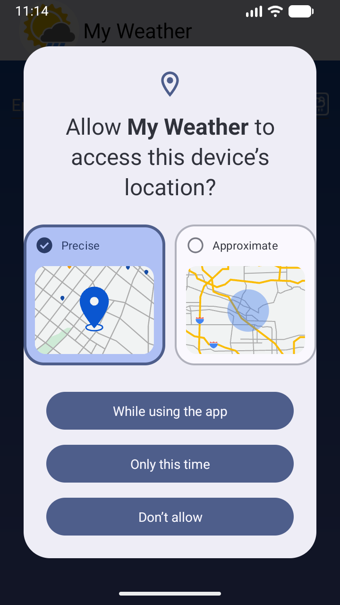
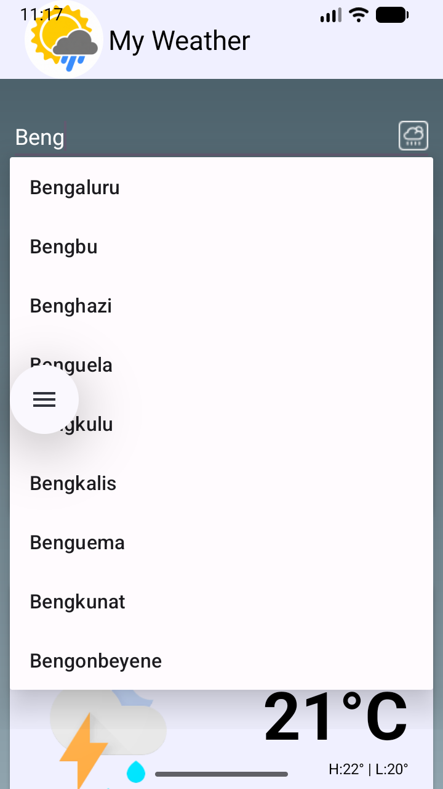
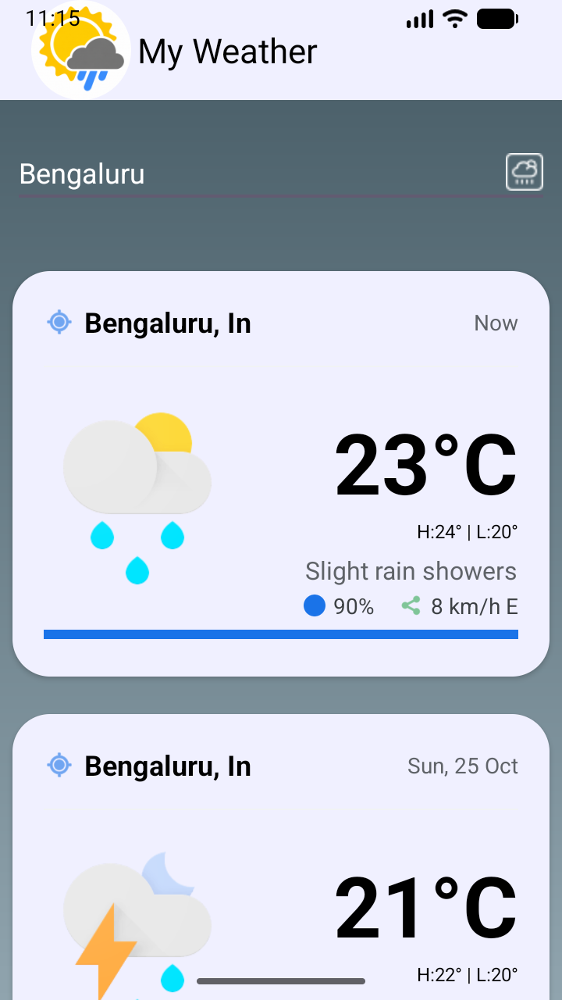

# My Weather ☀️🌧️❄️

**My Weather** is a modern, lightweight, and responsive Android weather forecasting application built in Java. It delivers real-time weather metrics, multi-day forecasts, location auto-suggestions, and dynamic theme transitions tailored to day and night weather conditions.

---

## 📸 Screenshots

| Location Permission | Location Search & Suggestions | Main Weather Display |
| :---: | :---: | :---: |
|  |  |  |

---

## ✨ Features

- 📍 **GPS & Location Detection**: Automatically detects user coordinates via Google Play Services `FusedLocationProviderClient` and resolves local address names using Android reverse geocoding.
- 🏙️ **City Auto-Suggestion Search**: Seamless search experience with auto-complete suggestions for major global cities using `AutoCompleteTextView`.
- 🌐 **Geocoding Integration**: Supports typing custom city names with auto-lookup converting city names to geographic coordinates via the Open-Meteo Geocoding API.
- 💾 **Smart Offline Fallback**: Caches the last searched city in `SharedPreferences`. If GPS is turned off or unavailable, the app seamlessly restores weather data for the saved location.
- 📅 **7-Day Detailed Forecast**: Renders daily forecast items in a structured `RecyclerView` showcasing max/min temperatures, average temperature, precipitation probability, humidity, and wind details.
- 🎨 **Dynamic Animated Themes**: Smoothly cross-fades background gradients (`TransitionDrawable`) and updates accent colors based on day/night conditions (Clear, Rain, Thunderstorm, Fog, etc.).
- 💨 **Comprehensive Metrics**: Displays temperature (°C), wind speed (km/h) with 16-point compass directions (N, ENE, SW, etc.), precipitation percentage, and humidity metrics.
- ✨ **Fluid Animations**: Features custom UI scaling and fade-in animations on weather metric updates.

---

## 🛠️ Tech Stack

- **Language**: Java
- **Target SDK**: 37 (Android 15) | **Min SDK**: 24 (Android 7.0 Nougat+)
- **Architecture**: Modular Asynchronous Architecture (`ExecutorService` + Main Thread `Handler`)
- **UI Components**:
  - `MaterialToolbar` & Material Design Components
  - `RecyclerView` with custom `CardView` items
  - `AutoCompleteTextView` with dropdown adapter
  - `ConstraintLayout` & `RelativeLayout`
- **Location & Geocoding**:
  - `com.google.android.gms:play-services-location` (`FusedLocationProviderClient`)
  - Android `Geocoder` (supports async listener on API 33+)
- **APIs & Libraries**:
  - **Open-Meteo Weather API** (Weather forecast & geocoding)
  - **Apache Commons Text** (`org.apache.commons:commons-text` for string capitalization utilities)
- **Build System**: Gradle with Version Catalog (`libs.versions.toml`)

---

## 📡 API Reference

My Weather fetches live meteorological data using the open-source **Open-Meteo API** (no API key required):
- **Geocoding API**: `https://geocoding-api.open-meteo.com/v1/search?name={city}`
- **Forecast API**: `https://api.open-meteo.com/v1/forecast?latitude={lat}&longitude={lon}&current=...&daily=...`

---

## 📁 Project Structure

```
MyWeather/
├── app/
│   ├── src/main/
│   │   ├── java/com/rd/myweather/
│   │   │   ├── MainActivity.java       # Main UI controller & lifecycle management
│   │   │   ├── WeatherFetcher.java     # HTTP requests, JSON parsing & Open-Meteo API wrapper
│   │   │   ├── LocationHelper.java     # Android reverse geocoding helper
│   │   │   ├── WeatherAdapter.java     # RecyclerView Adapter for daily forecast cards
│   │   │   └── Daily.java              # Weather data model for daily forecast
│   │   ├── res/
│   │   │   ├── anim/                   # Custom animation XMLs (fade_in_scale)
│   │   │   ├── drawable/               # Dynamic weather drawables & background gradients
│   │   │   ├── layout/                 # XML layouts (activity_main, item_card)
│   │   │   └── values/                 # Colors, themes, string arrays (cities list)
│   │   └── AndroidManifest.xml
├── screenshots/                        # App showcase screenshots
├── gradle/libs.versions.toml           # Dependency version catalog
├── build.gradle
└── settings.gradle
```

---

## 🚀 Getting Started

### Prerequisites

- **Android Studio**: Ladybug (2024.2.1) or newer recommended
- **JDK**: Java 11 or higher
- **Android SDK**: API Level 37 (Compile SDK) / Min SDK 24
- **Device/Emulator**: Physical Android device or Emulator running Android 7.0+ with Google Play Services enabled for location support.

### Installation

1. **Clone the repository**:
   ```bash
   git clone https://github.com/your-username/MyWeather.git
   cd MyWeather
   ```

2. **Open in Android Studio**:
   - Open Android Studio and choose **Open an Existing Project**.
   - Select the `MyWeather` root directory.

3. **Sync & Build**:
   - Allow Gradle to sync dependencies automatically.
   - Build the project using **Build > Make Project** or run via command line:
     ```bash
     ./gradlew assembleDebug
     ```

4. **Run the App**:
   - Connect an Android device or start an emulator.
   - Click **Run** (`Shift + F10`) in Android Studio.

---

## 🔑 Permissions

The application requests the following permissions at runtime:
- `android.permission.INTERNET` – Required to fetch weather and geocoding data from Open-Meteo services.
- `android.permission.ACCESS_COARSE_LOCATION` – Required for coarse GPS location detection.
- `android.permission.ACCESS_FINE_LOCATION` – Required for precise GPS location detection.

---

## 📄 License

This project is open-source and available under the [MIT License](LICENSE).
